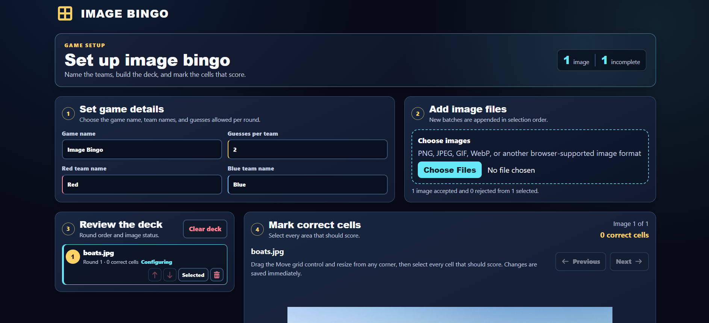
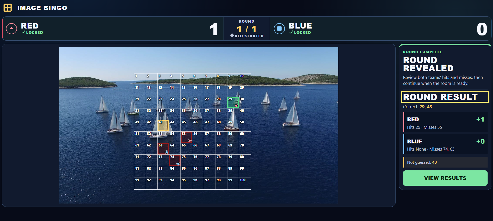
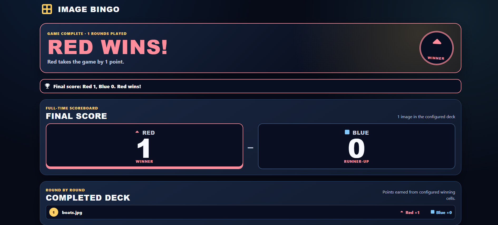

# Image Bingo

Image Bingo is a local, two-team party game built around your own pictures. A game master creates a deck, places a 10 × 10 numbered grid over each image, marks the winning cells, and then runs the game while the teams compete to find the right parts of the picture.

Everything runs in the browser—there is no account, server, or image upload.

## Screenshots

### Set up the game

Choose the team names and number of guesses, add images, arrange the round order, position the grid, and mark the cells that should score.

### Play a round

Teams take turns selecting numbered cells. Once both teams have locked their guesses, the game master reveals the image and the round is scored.

### Review the results

The results screen announces the winner, shows the final score, and provides a round-by-round recap.

## Features

- Build a multi-image deck from browser-supported image files.
- Reorder the deck with buttons or the keyboard.
- Move and resize a 10 × 10 grid independently for every image.
- Mark one or more correct cells for each round.
- Configure team names and 1–100 guesses per team.
- Present a clean, image-free introduction before starting the first round.
- Alternate the starting team between rounds.
- Lock each team's guesses before a timed 3–2–1 reveal.
- Score one point for each correctly guessed cell.
- Review hits, misses, unguessed correct cells, and the final match result.
- Replay with the same deck and configuration.
- Navigate the interactive grid and deck controls with a keyboard.

## How to play

1. Enter a game name, team names, and the number of guesses each team receives per round.
2. Add one or more images and arrange them in the order you want to play them.
3. For each image, position and resize the grid, then select every cell that should count as correct.
4. Start the game and use the presentation screen to introduce the teams.
5. Let the starting team choose and lock its cells, then repeat for the other team.
6. Reveal the image to score the round. Continue through the deck to see the final results.

## Data and privacy

Images are represented by temporary object URLs and stay in the current browser session. The app does not send them to a backend. Refreshing or closing the page clears the in-memory game, so finish the match before leaving the session.
