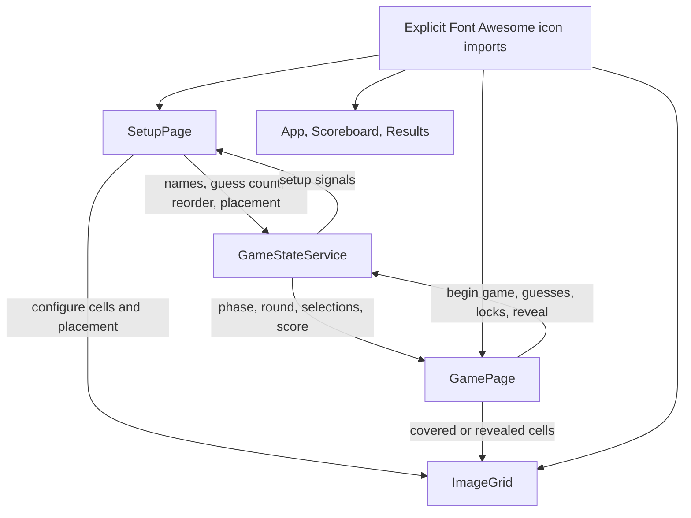
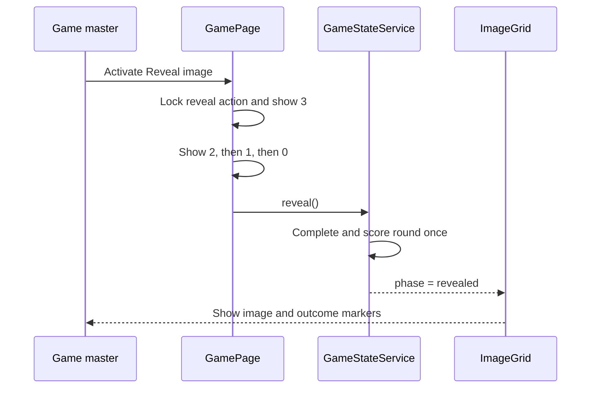

# Setup and Gameplay UX Improvements - Plan

## Goal Capsule

- **Objective:** The game master can prepare and present an image-bingo game without fighting oversized images, ambiguous controls, premature image exposure, or fixed two-guess rules.
- **Means:** Extend the central game state for deck ordering, guess configuration, and the presentation gate; keep grid geometry in the shared image-grid component; use the official Font Awesome Angular integration for visible icons. (KTD1-KTD6)
- **Authority:** The Product Contract owns user-visible behavior. The Planning Contract owns implementation choices within that behavior. Existing route guards, scoring rules, and proportional grid placement remain authoritative unless an R-ID changes them.
- **Execution profile:** Implement directly on `main`; do not create a branch or worktree.
- **Stop conditions:** Stop if the Font Awesome packages cannot support Angular 22, if the new presentation phase cannot remain compatible with the existing route guard, or if fit-to-view changes require changing stored grid-placement semantics.
- **Completion owner:** The implementing agent completes U1-U6, runs the Verification Contract, removes abandoned experimental code, and leaves `main` in a buildable state.

---

## Product Contract

### Summary

Improve setup and live play as one coherent flow: reorder images from the keyboard, configure grids against a fully visible image, choose a per-team guess count, introduce the game before round one, count down before reveal, simplify the play board, and replace improvised glyphs with consistent Font Awesome Free icons.

### Problem Frame

The current setup canvas enforces a minimum pixel width derived from a 40-pixel cell size. Large or extreme-aspect images therefore overflow the configuration panel and make the whole image hard to see while placing the grid. Several controls and status markers also rely on Unicode glyphs or CSS-drawn symbols whose baselines and scale vary.

The game currently creates and displays round one as soon as setup finishes. The two-guess rule is a compile-time constant repeated across state checks and screen-reader copy, so the game master cannot tailor it. Reveal is immediate, which removes the presentation beat needed before the whole image appears.

### Key Decisions

- **One shared guess limit applies to both teams.** (session-settled: user-approved — chosen over separate red and blue limits: one setup value keeps both teams under the same round rule.) Governs R6-R8.
- **Font Awesome Free replaces improvised user-facing glyph icons across the application.** (session-settled: user-approved — chosen over fixing only the two visibly misaligned symbols: a single icon system prevents the same baseline and sizing defects elsewhere.) Governs R13-R14.

### Requirements

**Deck setup and grid configuration**

- R1. In setup step 3, a focused image row can move one position earlier with ArrowUp and one position later with ArrowDown without losing focus or changing which image is being configured.
- R2. Reorder controls expose the same earlier/later actions for pointer and touch users, and boundary actions are disabled for the first and last images.
- R3. In setup step 4, the full source image fits inside the available configuration area for wide, tall, high-resolution, and small images without a forced intrinsic-width canvas.
- R4. The Move Grid control stays visually attached just above the movable grid and remains operable when the grid touches an image edge.
- R5. Resize handles show a centered icon while preserving pointer and keyboard resize behavior.

**Game rules and entry**

- R6. Setup offers one whole-number guesses-per-team setting from 1 through 100, defaults it to 2, and explains that it applies to each team in every round.
- R7. A team can select and lock exactly the configured number of guesses; selection availability, remaining-count calculations, and reveal eligibility all use that value.
- R8. The configured guess count survives deck clearing and results-to-setup replay alongside the existing game and team names.
- R9. Starting a configured game opens an image-free presentation screen on the play route with the game name, the red team name versus the blue team name, and a prominent “Let’s go” control.
- R10. Activating “Let’s go” begins round one once and only then makes the first image and gameplay controls available.

**Live play and visual feedback**

- R11. The visible image number and filename metadata strip is removed from the play board while the existing hidden round heading retains an accessible round and image name.
- R12. Reveal changes its button text to 3, 2, 1, then 0 at one-second intervals; the board remains covered and unscored until 0, and repeated activation cannot start another countdown.
- R13. Ownership markers scale down with small grid cells, retain distinguishable red and blue ownership, and do not obscure the cell number or outcome.
- R14. Hit, miss, configured-correct, navigation, status, team, replay, removal, movement, and other decorative glyph icons use explicitly imported Font Awesome Free icons with consistent centering and accessible surrounding text.

### Key Flows

- F1. **Configure the deck**
  - **Trigger:** The game master imports at least two images.
  - **Actors:** Game master.
  - **Steps:** Set names and guess count; reorder images; configure each image against a fit-to-view canvas; move and resize the grid; mark correct cells.
  - **Outcome:** Setup retains the chosen deck order, active image, grid placements, correct cells, and shared guess limit.
  - **Covered by:** R1-R8.
- F2. **Introduce and start the game**
  - **Trigger:** The game master activates Start game after setup is complete.
  - **Actors:** Game master and players.
  - **Steps:** Show the presentation screen without an image; activate “Let’s go”; initialize the first playable turn.
  - **Outcome:** Players see round one only after the explicit presentation handoff.
  - **Covered by:** R9-R10.
- F3. **Lock guesses and reveal**
  - **Trigger:** Both teams have locked the configured number of guesses.
  - **Actors:** Game master and both teams.
  - **Steps:** Start the reveal countdown; keep the covered board stable through 3, 2, and 1; reveal and score at 0.
  - **Outcome:** The completed round appears once with centered, legible ownership and outcome markers.
  - **Covered by:** R7, R11-R14.

### Acceptance Examples

- AE1. **Keyboard reorder preserves identity**
  - **Covers:** R1-R2.
  - **Given:** The second of three images is focused and is also the configured image.
  - **When:** The game master presses ArrowUp.
  - **Then:** That image becomes first, retains focus, remains the configured image, and the first-row earlier action becomes disabled.
- AE2. **Extreme images remain fully visible**
  - **Covers:** R3-R5.
  - **Given:** A very tall or very wide image is open in step 4.
  - **When:** The configuration panel renders at desktop or mobile width.
  - **Then:** The complete image is visible within the available canvas, the grid aligns to the same fractional placement, and move and resize controls remain reachable.
- AE3. **Presentation hides round one**
  - **Covers:** R9-R10.
  - **Given:** Setup is complete.
  - **When:** The game master activates Start game.
  - **Then:** The play route shows only the game name, team matchup, and “Let’s go”; no first-image element or board is rendered until “Let’s go” is activated.
- AE4. **Configured guess count governs both teams**
  - **Covers:** R6-R8.
  - **Given:** Guesses per team is set to 3.
  - **When:** Each team plays a turn.
  - **Then:** Each team must select exactly three cells before locking, a fourth unselected cell is unavailable, and reveal becomes available only after both three-cell selections are locked.
- AE5. **Reveal happens at zero once**
  - **Covers:** R12.
  - **Given:** Both teams are locked and the board is covered.
  - **When:** Reveal is activated more than once during the countdown.
  - **Then:** One countdown displays 3, 2, 1, 0; scoring and image reveal happen only at 0 and only once.
- AE6. **Small markers remain readable**
  - **Covers:** R13-R14.
  - **Given:** The configured grid is near its minimum size and a revealed cell contains shared ownership plus a miss.
  - **When:** The board renders.
  - **Then:** Both team colors and the centered miss icon remain distinguishable without covering the cell number.

### Scope Boundaries

- Preserve the 10×10 grid, existing scoring model, alternating starting team, proportional `GridPlacement` data, import validation, object-URL cleanup, and results calculations.
- Keep setup, play, and results as the existing three routes. The presentation screen is a play phase, not a fourth route.
- Keep the reveal interval at one second per number. Reduced-motion preferences do not skip semantic countdown time.
- Numeric round labels, separators, and text remain text; Font Awesome replaces symbols that act as icons.

#### Deferred to Follow-Up Work

- Drag-and-drop deck ordering is not part of this change; keyboard and explicit earlier/later controls cover the requested ordering paths.
- Persisting games across browser refreshes remains deferred because current state is session-memory only.

### Success Criteria

- A game master can complete setup for extreme-aspect images without horizontal image panning to understand the full composition.
- Players cannot see the first image before the game master activates “Let’s go,” and cannot see or score a reveal before the countdown reaches 0.
- All visible count-dependent copy and controls remain correct for guess limits of 1, 2, and a larger value.

---

## Planning Contract

### Key Technical Decisions

- KTD1. **Represent the presentation as a first-class game phase.** Add a presentation phase that routes to `/play`, keeps the board unrendered, and transitions through a guarded service action into `guessing-first`. This preserves route-guard authority and survives component recreation better than a page-local introductory flag. Governs R9-R10.
- KTD2. **Keep guesses per team in shared game state.** Replace the global fixed guess limit with a validated setup value bounded by `CELL_COUNT`; every selection, lock, completion, reset, and copy path reads the service signal. Governs R6-R8.
- KTD3. **Reorder deck entries by image identity in the service.** Setup requests an adjacent move by image id; the service swaps immutable deck entries, rejects invalid or boundary moves, and recalculates `configurationIndex` from the configured image id. Scoped row key handling prevents arrow keys from interfering with page scrolling. Governs R1-R2.
- KTD4. **Fit the configuration board instead of preserving minimum cell pixels.** Remove configure-mode `minimumBoardWidth` constraints and use the same intrinsic-aspect containment principle already used in covered/revealed modes. Fractional placement remains unchanged, so saved geometry continues to map to the source image. Governs R3-R5.
- KTD5. **Keep reveal countdown state in `GamePage`, but scoring in `GameStateService`.** A component signal and cancellable timer own 3-to-0 presentation; the existing guarded `reveal()` mutation runs only at zero. This avoids polluting durable game phases with transient seconds while retaining single-scoring authority. Governs R12.
- KTD6. **Use the official Font Awesome Angular wrapper with explicit icon imports.** Add `@fortawesome/angular-fontawesome` 5.x for Angular 22 and `@fortawesome/free-solid-svg-icons`; components bind individual icons so unused artwork can be tree-shaken. Decorative icons remain hidden from assistive technology while labels stay on their controls. Governs R13-R14. See [official compatibility guidance](https://github.com/FortAwesome/angular-fontawesome/blob/main/docs/guide/compatibility.md) and [Font Awesome SVG-core guidance](https://docs.fontawesome.com/web/dig-deeper/svg-core).
- KTD7. **Add the Angular 22 Vitest target before changing stateful behavior.** The repository currently has no test target or specs. Add the official `@angular/build:unit-test` configuration with Vitest and jsdom, then cover service transitions, DOM interactions, and fake-time countdown behavior. See [Angular testing setup](https://angular.dev/guide/testing) and [component testing guidance](https://angular.dev/guide/testing/components-basics).

### High-Level Technical Design

The central service remains the only owner of persistent game state. Pages translate user actions into guarded service mutations, while `ImageGrid` owns proportional rendering and direct placement interaction.



The presentation phase separates setup completion from round-one exposure without adding a route.

```mermaid
stateDiagram-v2
  [*] --> setup
  setup --> presentation: Start game
  presentation --> guessing-first: Let's go
  guessing-first --> guessing-second: First team locks configured guesses
  guessing-second --> ready-to-reveal: Second team locks configured guesses
  ready-to-reveal --> revealed: Countdown reaches 0
  revealed --> guessing-first: Next image
  revealed --> finished: Final results
  finished --> setup: Return to setup
```

Reveal stays a page-level timed interaction until the terminal service mutation.



### Sequencing

1. Establish the dependency and test foundation in U1.
2. Add state-model behavior in U2 before pages depend on new signals and actions.
3. Implement setup behavior in U3 and grid behavior in U4; they may proceed independently after U2 where their paths do not overlap.
4. Implement the play presentation and countdown in U5 after the phase and guess-count contracts exist.
5. Finish application-wide icon migration and visual regression coverage in U6 after the icon foundation is stable.

### System-Wide Impact

- **State lifecycle:** `guessesPerTeam` must be present in every `GameState` variant and preserved by `clearDeck()` and `returnToSetup()`. The presentation phase must map to `/play` and count as in progress for unload warnings.
- **Deck semantics:** Reordering changes round order and, because starter selection depends on deck index, which team starts a given image. This is intended.
- **Accessibility:** Focus follows a reordered row, the presentation heading receives entry focus, the round heading receives focus after “Let’s go,” countdown changes are announced without duplicating live regions, and icon SVGs do not replace accessible names.
- **Bundle and styling:** Explicit Font Awesome imports limit bundle growth. Tiny grid markers require component-relative SVG sizing and forced-colors verification.

### Risks & Dependencies

- Font Awesome icon export names can differ across major icon packs. Confirm each chosen Free Solid export against the installed package and let the build reject missing names.
- A move handle positioned outside the placement rectangle can be clipped when the grid reaches the image top edge. Reserve control clearance or use a bounded overlap that remains inside the board.
- Removing the 40-pixel minimum makes cells visually smaller on tall or wide images. Preserve roving keyboard operation, visible focus, and practical pointer hit areas on placement controls even when cell contents scale down.
- Timer teardown must prevent a delayed reveal after navigation or destruction. Fake-time tests must cover cancellation and repeat activation.
- The repository currently skips generated tests and has no test target. U1 is a prerequisite, not an optional cleanup.

### Sources / Research

- `src/app/models/game.models.ts` defines the phase union, shared state shapes, 10×10 grid constants, and the current fixed guess limit.
- `src/app/core/game-state.service.ts` owns immutable deck mutations, route authority, guess locking, reveal scoring, and reset behavior.
- `src/app/features/setup/setup-page.ts`, `src/app/features/setup/setup-page.html`, and `src/app/features/setup/setup-page.scss` implement the five-step setup flow and deck list.
- `src/app/shared/image-grid/image-grid.ts`, `src/app/shared/image-grid/image-grid.html`, and `src/app/shared/image-grid/image-grid.scss` own proportional placement, pointer/keyboard movement, minimum-width overflow, and markers.
- `src/app/features/game/game-page.ts`, `src/app/features/game/game-page.html`, and `src/app/features/game/game-page.scss` own play-page copy, board metadata, reveal action, and focus announcements.
- Commits `51a731d`, `08834f6`, and `9ade484` establish the current movable-grid, viewport-fit, and ownership-marker patterns.
- The [official Angular Font Awesome compatibility table](https://github.com/FortAwesome/angular-fontawesome/blob/main/docs/guide/compatibility.md) maps wrapper 5.x to Angular 22.x.
- The [Angular testing overview](https://angular.dev/guide/testing) documents Vitest, jsdom, and the `@angular/build:unit-test` builder for current Angular projects.

---

## Implementation Units

### U1. Establish icon and test foundations

- **Goal:** Add the supported Font Awesome Free integration and a runnable Angular 22 unit-test target before feature behavior changes.
- **Requirements:** R13-R14 and the verification needs for R1-R12.
- **Dependencies:** None.
- **Files:** `package.json`, `pnpm-lock.yaml`, `angular.json`, `tsconfig.spec.json`, `src/app/shared/icons/game-icons.ts`.
- **Approach:**
  1. Add the Angular-22-compatible Font Awesome wrapper and Free Solid icon pack.
  2. Export only the icon definitions used by the application from a small shared catalog; consuming standalone components still import the Font Awesome rendering component explicitly.
  3. Add Vitest and jsdom, the `@angular/build:unit-test` target, the test TypeScript configuration, and a `test` package script.
- **Patterns to follow:** Match existing exact dependency pinning and standalone component imports in `package.json` and `src/app/**/*.ts`.
- **Test scenarios:** Test expectation: none -- this unit adds dependency and test scaffolding without changing rendered behavior.
- **Verification:** Dependency resolution updates the lockfile, `ng test` discovers colocated specs, and the production build accepts a representative imported Free Solid icon.

### U2. Extend central state for presentation, guess count, and deck order

- **Goal:** Make the new setup choices and pre-game gate authoritative in `GameStateService`.
- **Requirements:** R1-R2, R6-R10.
- **Dependencies:** U1.
- **Files:** `src/app/models/game.models.ts`, `src/app/core/game-state.service.ts`, `src/app/core/game-state.service.spec.ts`, `src/app/core/game-flow.guard.spec.ts`.
- **Approach:**
  1. Add the presentation phase and a state shape that can route to play without exposing an active round before R10.
  2. Store `guessesPerTeam` in shared state with default 2 and bounds derived from `CELL_COUNT` per KTD2.
  3. Replace every service-level fixed-limit comparison with the configured value, including team-completion checks.
  4. Add setup-only adjacent reordering by image id per KTD3 and preserve the configured image by identity.
  5. Preserve guess configuration through deck clearing and replay, and add the guarded presentation-to-round-one transition per KTD1.
- **Execution note:** Implement the new state transitions test-first because later units depend on their exact guards and reset semantics.
- **Patterns to follow:** Immutable state updates, early-return guards, computed public signals, `removeImage()` identity preservation, `routeForPhase()`, and `createRound()` in `src/app/core/game-state.service.ts`.
- **Test scenarios:**
  1. Start from valid setup and call Start game; expect presentation on `/play`, no current round, and no current image exposed to the page contract.
  2. Call the begin action in presentation; expect round one, image index 0, and the existing alternating starter.
  3. Call either transition from an invalid phase or twice; expect no state change and no duplicate round.
  4. Set guesses to 1, 2, 3, 100, 0, 101, and a non-integer; expect accepted values within bounds and deterministic rejection or normalization outside them.
  5. With limit 3, select three cells, reject a fourth, allow deselection, require three selections before locking, and require both locked three-cell teams before reveal.
  6. Clear the deck and return from results; expect names and guess count preserved while round selections and history reset.
  7. Move a middle image earlier and later; expect deck order to change while `configurationImage()` keeps the same id.
  8. Move first earlier, last later, an unknown id, or move outside setup; expect no state change.
  9. Request `/play` during presentation; expect the guard to allow it, while setup and results redirect to the authoritative play route.
- **Verification:** All phase, limit, reset, route, and reorder cases pass without changing scoring, starter alternation, or object-URL ownership.

### U3. Add setup guess and keyboard-order controls

- **Goal:** Let the game master configure guesses and reorder deck rows with keyboard, pointer, or touch input.
- **Requirements:** R1-R2, R6, R8-R9, R14.
- **Dependencies:** U1, U2.
- **Files:** `src/app/features/setup/setup-page.ts`, `src/app/features/setup/setup-page.html`, `src/app/features/setup/setup-page.scss`, `src/app/features/setup/setup-page.spec.ts`.
- **Approach:**
  1. Add a labeled numeric guess control to step 1, with min/max/step constraints and copy explaining that it applies to each team.
  2. Make each deck row a scoped keyboard reorder target and delegate adjacent movement to the service.
  3. Add visible earlier/later icon controls with image-specific accessible labels and disabled boundary states.
  4. Restore focus to the moved row by stable image id and announce the new round position.
  5. Update readiness and Start game copy to describe the presentation handoff rather than immediate round-one display.
  6. Replace setup glyph icons with the catalog from U1 while preserving button text and accessible labels.
- **Patterns to follow:** Existing signal-based computed view state, view queries and microtask focus scheduling, controlled name inputs, and setup live-status announcements.
- **Test scenarios:**
  1. Covers AE1. Focus the middle row and send ArrowUp/ArrowDown; expect adjacent order changes, focus retention, active configuration identity, and updated position copy.
  2. Send unrelated keys or arrow keys from a nested text/number input; expect no reorder and normal input behavior.
  3. Activate earlier/later buttons at middle and boundary positions; expect the same service behavior and correct disabled states.
  4. Enter 1, 2, 3, and 100 in the guess field; expect the service signal and setup value to agree with correct explanatory copy.
  5. Attempt invalid, fractional, or empty guess input; expect the chosen validation behavior without corrupting the last valid state.
  6. Complete setup and activate Start game; expect navigation to `/play` with presentation copy rather than round-one guidance.
- **Verification:** Step 3 supports scoped physical arrow keys plus discoverable buttons, step 1 controls the shared guess value, and screen-reader announcements identify moved image and new position.

### U4. Make grid configuration fit-to-view and polish markers

- **Goal:** Keep the full image visible during configuration and make grid controls and cell markers scale and center reliably.
- **Requirements:** R3-R5, R13-R14.
- **Dependencies:** U1, U2.
- **Files:** `src/app/shared/image-grid/image-grid.ts`, `src/app/shared/image-grid/image-grid.html`, `src/app/shared/image-grid/image-grid.scss`, `src/app/shared/image-grid/image-grid.spec.ts`, `src/app/features/setup/setup-page.scss`.
- **Approach:**
  1. Remove configure-mode minimum-board sizing and horizontal overflow coupling per KTD4; contain the board by available width and a viewport-aware height while preserving intrinsic aspect ratio.
  2. Move the existing move handle into the placement overlay so it follows the grid, using reserved clearance or bounded overlap to remain visible at the image top edge.
  3. Preserve the existing pointer capture, fractional normalization, arrow-key movement, Shift step, and corner-resize calculations.
  4. Replace CSS-drawn or glyph control/outcome symbols with centered Font Awesome components.
  5. Separate ownership-marker sizing from outcome-marker sizing, reduce its container-relative clamps, and retain two colored dots for shared ownership.
  6. Keep forced-colors and visible-focus rules for controls and cells.
- **Patterns to follow:** Existing covered/revealed aspect containment, `activePlacement` computed geometry, `placement-controls`, container query units, and forced-colors styles.
- **Test scenarios:**
  1. Covers AE2. Render wide, tall, high-resolution, and small intrinsic dimensions; expect no configure-mode minimum width and a board aspect matching the source image.
  2. Move the grid with pointer and keyboard after fit-to-view; expect emitted fractional placement to match the existing normalized behavior.
  3. Resize from all four corners with pointer and keyboard, including Shift-modified steps; expect bounded placement and an unchanged accessible resize contract.
  4. Place the grid at each image edge; expect the Move Grid control to remain visible, focusable, and separate from corner handles.
  5. Covers AE6. Render minimum-size red, blue, shared, hit, miss, and correct-unselected cells; expect distinct markers and Font Awesome SVGs centered inside their marker boxes.
  6. Render in forced-colors mode and inspect keyboard focus; expect visible borders/focus and no information conveyed by icon color alone.
- **Verification:** The entire setup image remains visible at representative desktop and mobile sizes, placement math is unchanged, and all move/resize/marker interactions remain usable.

### U5. Add presentation and timed reveal to the play page

- **Goal:** Gate round-one exposure behind “Let’s go,” make gameplay copy honor the configured guess count, and reveal only after a visible countdown.
- **Requirements:** R7, R9-R12, R14.
- **Dependencies:** U1, U2, U4.
- **Files:** `src/app/features/game/game-page.ts`, `src/app/features/game/game-page.html`, `src/app/features/game/game-page.scss`, `src/app/features/game/game-page.spec.ts`.
- **Approach:**
  1. Branch the page on the presentation phase before constructing scoreboard or image-grid markup.
  2. Render the game name, team matchup, and “Let’s go” action; focus the presentation heading on entry and the hidden round heading after transition.
  3. Remove board metadata markup and styles while retaining the hidden round/image heading.
  4. Replace fixed “two,” “four,” `/2`, and `MAX_GUESSES` copy with computed numeric/pluralized values from the service.
  5. Implement KTD5 with one cancellable countdown, locked reveal action, live announcements, and timer cleanup on destruction.
  6. Switch play-page glyphs to the shared Font Awesome catalog.
- **Execution note:** Write presentation and fake-time countdown tests before connecting the final service reveal call.
- **Patterns to follow:** Existing phase-derived computed copy, view-child focus scheduling, live announcement signal, guarded navigation, and service-owned scoring.
- **Test scenarios:**
  1. Covers AE3. Enter presentation; expect game/team names and “Let’s go,” and expect no scoreboard, image element, or grid in the DOM.
  2. Activate “Let’s go” twice; expect one transition, one round, the first image rendered afterward, and focus on the round heading.
  3. Set guess limits to 1, 2, and 3; expect turn guidance, selected counts, lock announcements, ready copy, and disabled-cell descriptions to use the configured number with correct grammar.
  4. Confirm the visible board metadata strip is absent while the hidden heading still names round and image.
  5. Covers AE5. With fake time, activate Reveal; expect 3 immediately, then 2, 1, 0 at one-second ticks, a covered/unscored board before zero, and one service reveal at zero.
  6. Activate Reveal repeatedly during countdown; expect no restart, overlap, early reveal, or duplicate score.
  7. Destroy or navigate away during countdown; expect the timer cancelled and no delayed service mutation.
  8. Complete countdown with reduced-motion preference; expect the semantic timing to remain unchanged.
- **Verification:** The first image is absent before the CTA, all guess-dependent copy follows configuration, and reveal/scoring occur once at countdown zero.

### U6. Complete application-wide Font Awesome migration

- **Goal:** Remove remaining improvised glyph icons from the shell, scoreboard, results, and any touched control while preserving meaning and layout.
- **Requirements:** R13-R14.
- **Dependencies:** U1, U3-U5.
- **Files:** `src/app/app.ts`, `src/app/app.html`, `src/app/app.scss`, `src/app/app.spec.ts`, `src/app/shared/scoreboard/scoreboard.ts`, `src/app/shared/scoreboard/scoreboard.html`, `src/app/shared/scoreboard/scoreboard.scss`, `src/app/shared/scoreboard/scoreboard.spec.ts`, `src/app/features/results/results-page.ts`, `src/app/features/results/results-page.html`, `src/app/features/results/results-page.scss`, `src/app/features/results/results-page.spec.ts`.
- **Approach:**
  1. Replace brand, completion, team, lock/active/waiting, starter, winner, trophy, navigation, and replay glyphs with semantic Free Solid icons from U1.
  2. Remove string-returning icon computations where an icon definition is the correct value.
  3. Normalize SVG dimensions and alignment through component-local classes; preserve team color treatments and forced-colors behavior.
  4. Keep numeric round markers, text separators, and accessible labels as text.
- **Patterns to follow:** Standalone imports, existing `aria-hidden` decoration, `title` attributes on truncated team names, and component-scoped SCSS.
- **Test scenarios:**
  1. Render setup, play, and results states; expect Font Awesome SVG components in every icon role and no legacy Unicode icon glyphs in templates.
  2. Render locked, active, waiting, winner, draw, and replay variants; expect the correct icon definition and unchanged accessible state text.
  3. Render long team names and narrow layouts; expect icons not to shrink labels or break truncation.
  4. Inspect forced-colors mode; expect icons to remain visible and all meaning to remain available in text or accessible labels.
- **Verification:** A repository search finds no remaining user-facing icon glyphs in application templates, tests pass for state-specific mappings, and visual checks show centered SVGs at supported breakpoints.

---

## Verification Contract

| Gate | Command or method | Proves | Units |
|---|---|---|---|
| Unit and component tests | `pnpm test -- --no-watch --no-progress` | State guards, resets, reordering, page DOM, focus, timer behavior, and icon mappings | U1-U6 |
| Production build | `pnpm build` | Angular templates, strict TypeScript, SCSS budgets, and Font Awesome exports compile | U1-U6 |
| Setup browser pass | Exercise step 1, step 3, and step 4 at desktop, tablet, and 320px width with wide, tall, high-resolution, and small images | Keyboard order, focus, full-image fit, edge controls, markers, and responsive layout | U3-U4 |
| Game browser pass | Run presentation, 1/2/3-guess rounds, countdown, next round, results, and replay | End-to-end state transitions, hidden first image, dynamic copy, single scoring, and preserved configuration | U2, U5-U6 |
| Accessibility pass | Use keyboard-only navigation, inspect live announcements, and check forced-colors/reduced-motion modes | No global arrow interception, useful focus movement, named controls, and non-color-only status | U3-U6 |
| Regression pass | Exercise grid selection, pointer move/resize, Shift+arrow steps, scoring, starter alternation, and route redirects | Requested changes preserve the existing game contract | U2-U5 |

---

## Definition of Done

- R1-R14 and AE1-AE6 are implemented and traceable to passing automated or browser verification.
- U1-U6 are complete in dependency order with no launch-blocking question left open.
- `pnpm test -- --no-watch --no-progress` and `pnpm build` pass in the normal implementation environment.
- No first-image element is rendered before “Let’s go,” and no reveal or scoring mutation occurs before countdown zero.
- Guess limits of 1, 2, 3, and 100 behave consistently across setup, gameplay, reset, and replay.
- Extreme-aspect images are fully visible in setup, and move/resize controls remain reachable at all grid boundaries.
- User-facing glyph icons are replaced with Font Awesome Free icons; numeric and textual symbols intentionally retained as text are documented by the scope boundary.
- Keyboard focus, live regions, forced colors, and reduced motion preserve the existing accessibility contract.
- The diff contains no abandoned timer, sizing, icon, or state experiments, and unrelated generated or build files are not committed.
